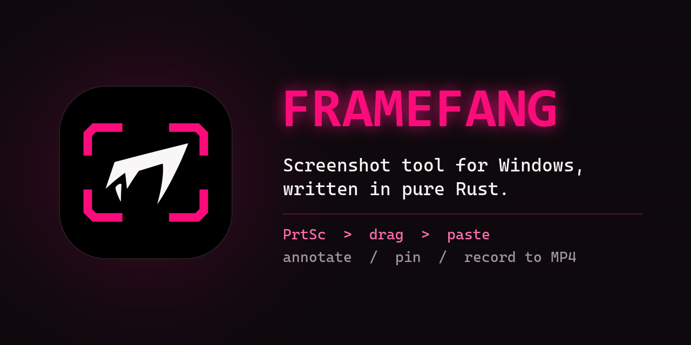
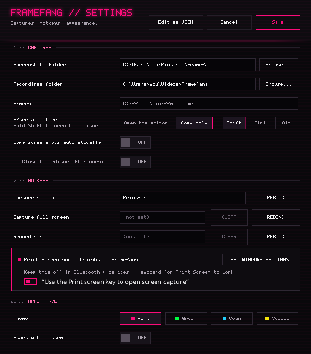

<!-- markdownlint-disable MD013 MD033 MD041 -->
<!-- Centered HTML header and wide table rows are deliberate on GitHub. -->

<p align="center">
  
</p>

<p align="center">
  <a href="https://github.com/winters27/framefang/releases/latest"></a>
  <a href="https://github.com/winters27/framefang/releases"></a>
  
  
</p>

<p align="center">
  <b>Press Print Screen, drag over what you want, paste it anywhere.</b><br>
  A fast, free screenshot and screen capture tool that lives in your tray.
</p>

## Why Framefang

Framefang is a lightweight **Snipping Tool alternative** for Windows 10 and 11,
written in pure Rust with no web view, no Electron and no background
services. It uses about 16 MB of memory while it waits in the tray, and a
screenshot takes about as long as dragging a box.

- **Instant freeze.** The screen freezes the moment you press the key, so the
  menu or tooltip you were hovering is still in the shot.
- **Copy only, or edit.** Pick what a capture does: copy the region straight
  to the clipboard and get out of the way, or open the editor. Hold a key
  (Shift, Ctrl or Alt) to do the other one for a single capture.
- **Edit in place.** The editor opens right where the picture was on your
  screen, with its tools beside it and the rest of your desktop live around
  it.
- **Private by design.** Nothing is uploaded. The only network requests go
  to GitHub, for update checks and the optional FFmpeg download.

## Download

Get **`Framefang.msi`** from the
[latest release](https://github.com/winters27/framefang/releases/latest) and
run it. There is also a portable `framefang-windows-x86_64.zip` holding just
`framefang.exe`. Framefang updates itself from the tray menu.

> **Windows 11 sends Print Screen to the Snipping Tool by default.**
> Framefang's Settings shows the exact Windows switch to turn off and has a
> button that opens its page. Or bind any other key you like.

## Features

| | |
| --- | --- |
| **Region capture** | Drag over any part of any monitor, across mixed scaling and multiple screens. |
| **Full-screen capture** | Bind a key and it saves the whole desktop to your screenshots folder. |
| **Annotate** | Pen, line, arrow, box, circle, highlighter, text, numbered steps and pixelate (to blur out private details). Each tool keeps its own color and size. |
| **Copy, save or pin** | Copy to the clipboard, save as PNG, or pin the picture as an always-on-top window. |
| **Copy-only mode** | Captures go straight to the clipboard with no editor, ready to paste into chat, email or docs. |
| **Screen recorder** | Record the screen or a region to MP4, with system audio and microphone. |
| **Converters** | Convert images (PNG, JPG, WEBP, BMP) and videos (MP4, MOV, WEBM, MKV, GIF). |
| **Any key as a hotkey** | Print Screen, F13 to F24, Pause, media keys, or any chord with Ctrl, Alt or Win. |
| **Color schemes** | Pink, Green, Cyan or Yellow, with a retro terminal look. |

Screen recording and video conversion need FFmpeg. If you don't have it,
Settings downloads Framefang's own trimmed build (about 10 MB) and checks it
against its published checksum. Or install it yourself:

```powershell
winget install Gyan.FFmpeg
```

<p align="center">
  
</p>

## Keyboard shortcuts

In the capture editor:

| Key | Does |
| --- | --- |
| `P` `L` `A` `R` `E` | Pen, line, arrow, box, circle |
| `M` `T` `N` `B` | Highlighter, text, numbered step, pixelate |
| `S` | Select and move what you drew |
| `Ctrl+Z` / `Ctrl+Y` | Undo / redo |
| `Ctrl+C` | Copy to the clipboard |
| `Ctrl+S` or `Enter` | Save |
| `Ctrl+P` | Pin on top of other windows |
| `Esc` | Put the tool down, then close |

## Coming from another tool?

Framefang covers the everyday screenshot loop of the **Windows Snipping
Tool**, **Snip & Sketch**, **ShareX**, **Greenshot**, **Lightshot** and
**Flameshot**: capture a region, mark it up, copy or save it. It keeps to that
loop and does it quickly. There are no uploaders, no accounts and no
workflows to configure.

## FAQ

**How do I make Print Screen open Framefang instead of the Snipping Tool?**
Open Framefang's Settings. While Print Screen is your capture key, it shows
the Windows switch to turn off (Bluetooth & devices > Keyboard on Windows 11)
and a button that opens that page.

**Can I take a screenshot without the editor opening?**
Yes. In Settings, set **After a capture** to **Copy only**. The region goes to
your clipboard as soon as you let go. Hold your switch key (Shift by default)
when you want the editor for that one capture.

**Where are screenshots saved?**
In your Pictures folder unless you pick another one in Settings. Copy-only
captures go to the clipboard and are not saved to disk.

**Does it work with multiple monitors and high-DPI screens?**
Yes. The capture spans every monitor and maps your selection back to real
pixels on scaled displays.

## Building from source

Rust 1.80 or later.

```bash
cd framefang-rs
cargo test --release --workspace
cargo build --release -p framefang-app
```

The app is `framefang-rs/target/release/framefang.exe`. A local build copies
the `ffmpeg` on `PATH` (or the one `FRAMEFANG_FFMPEG` names) next to it.

Releases are built by GitHub Actions (`.github/workflows/release.yml`) when a
`v*` tag is pushed: the MSI, the portable zip and `SHA256SUMS`.

Linux and macOS share most of the code, but have no release builds yet and
are untested.
